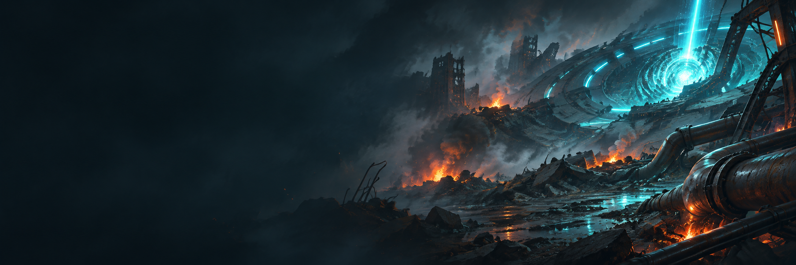

<div align="center">

# Alienation - PC Port

### Alienation, Housemarque's PS4 twin-stick shooter, running natively on Windows, and experimentally on Linux and Steam Deck, with online and local co-op, the TRG launcher and modern PC graphics options

[](https://github.com/saulob/alienation-pc/releases/latest)
[](https://github.com/saulob/alienation-pc/releases)


<sub>The original Alienation PS4 x86-64 game code runs on the PC with a replacement for the PS4 system libraries and a Vulkan renderer derived from <a href="https://github.com/shadps4-emu/shadPS4">shadPS4</a>. <b>The game itself is not included</b>: bring your own legally obtained, supported Alienation PS4 package.</sub>

</div>

<p align="center"></p>

## Status

- **v0.1.0 is the first public release.**
- **Windows is the primary tested platform.** The Linux x86_64 AppImage and Steam Deck support are **experimental**: they are checked headlessly, but have not been tested on Steam Deck hardware.
- **Vulkan is the only supported release renderer.**
- **Online 2-player** gameplay has been tested by hand. **3 and 4-player** online protocol and session paths are validated headlessly and have had less manual gameplay testing.
- **Local co-op** exists on CUSA00062 1.06 / DUPLEX only.

Release notes, including known issues: [docs/releases](docs/releases).

## Features

- **Native PC port**: the game's own x86-64 code runs directly on the PC. It is not an emulator, and on Linux it needs no Wine or Proton
- **Online co-op for 2 to 4 players** through the game's own squad menus, with no PlayStation Network account. See [Online Co-op](#online-co-op)
  - **Public Lobby** and public rooms, **Friends**, **Friend Codes** and **friend requests**, **invites** and **Accept and play**
  - **Direct P2P gameplay** with **automatic relay fallback**, and **Windows / Linux cross-platform** online play
- **Local co-op for up to 4 players** on CUSA00062 1.06 / DUPLEX. See [Local Co-op](#local-co-op)
- **Built-in Bug Report page** with a previewed, filtered log. See [Bug Report](#bug-report)
- **4K internal render resolution** (480p to 4K), separate from the window size
- **True Ultrawide** (experimental) with 21:9 and 32:9
- **Presentation modes** of 30 / 60 / 90 / 120 / 144 / 165 / 240 / Unlimited FPS. See [Frame rate](#frame-rate)
- **Vulkan**, **SMAA**, **FSR 1** with **RCAS**, **anisotropic filtering** and **VSync**. See [Graphics and display](#graphics-and-display)
- **Xbox prompts**, **PlayStation and Xbox controllers** and **keyboard**
- **Skip Intro**, and **Exit Game** as the last row of the Options and Select Campaign menus, in the game's language
- **Trophies**, local and offline on this PC, on the launcher's Trophies page
- **Portable saves**: the game, saves, settings and logs stay beside the program
- **Built-in updater** that offers new releases from this repository and never touches the game, saves or settings
- **TRG launcher** that installs the game from your own `.pkg`, installs and removes the 1.06 update, and remembers its window position
- **Asian Menu Buttons** option (Circle confirms, Cross cancels) for CUSA04430 and CUSA00062 1.06, and a Portuguese voice-language text correction on ASIA/KR
- **18 text languages** on the 1.06 and ASIA/KR builds. See [Languages](#languages)

## Graphics and display

- **Windowed** and **Borderless Fullscreen**, switched with **F11** while playing
- **Monitor selection** and **graphics card selection** (any Vulkan graphics card the renderer can use)
- **VSync** on or off
- **Render resolution**: 480p, 720p, Native 1080p, 1440p, 1800p and 4K, the game's internal render resolution rather than window scaling
- **Aspect Ratio**: 16:9, 16:10, 21:9, 32:9, 4:3 and 5:4
- **True Ultrawide** (experimental): 21:9 and 32:9 show more of the world at the sides instead of stretching the picture
- **FSR 1** upscaling and **RCAS** sharpening
- **SMAA** anti-aliasing and **anisotropic texture filtering**
- **FPS counter** (**F2**), and frame rate and render resolution in the window title
- **Vulkan** is the only renderer

### Frame rate

The **Frame rate** option (Gameplay page) offers 30, 60 (Original, default), 90, 120, 144, 165, 240 or Unlimited frames per second reaching the window.

60 is the original game rate and stays the simulation rate: the game makes 60 new frames a second at its original speed whatever the setting, so gameplay, online play and local co-op never change. 30 shows every second frame. Faster rates **repeat the latest game frame** until the next one: there is **no interpolation**, and the game does not simulate at 120 Hz or above. Repeats go up to the display's refresh with VSync on and up to 480 a second for Unlimited. The window title shows every presentation, with the game's new frames in brackets while frames are repeated: `FPS: 144.00 (game 60.00)`.

## Download and install

Download from the [latest release](https://github.com/saulob/alienation-pc/releases/latest); each file has a `.sha256` beside it. **No game files are included.** Both platforms need a processor with AVX and LZCNT (Intel Haswell, AMD FX or newer) and a Vulkan 1.3 driver.

**Windows 10 (1903) or 11, 64-bit:** `AlienationPC-v<version>-windows-x64.zip`

1. Extract the ZIP into a folder you can write to (not Program Files).
2. Run `alienation.exe`. The launcher opens.
3. On the Play page press **Install game...** and select your `.pkg`. When it says Ready to play, press **PLAY**.

**Linux x86_64 (experimental):** `AlienationPC-v<version>-x86_64.AppImage`. See [Linux and Steam Deck](#linux-and-steam-deck).

**Steam Deck (experimental):** the same AppImage, set up in Desktop Mode. See [Linux and Steam Deck](#linux-and-steam-deck).

The built-in updater offers new releases from this repository and installs them without touching the game, saves or settings. How releases are built, checked and installed: [docs/release.md](docs/release.md).

## Supported builds

| Build | Title ID | Version | Packages | Content ID | eboot.bin SHA-256 |
|---|---|---|---|---|---|
| CUSA00062 1.00 · EUR | `CUSA00062` | 1.00 | base | `EP9000-CUSA00062_00-ALIENATIONGAMEEU` | `f5f41f870db752add56920c5538441bc3750b1442f69c1de3895ee282887d855` |
| CUSA00062 1.06 · EUR | `CUSA00062` | 1.06 | base + update, or the DUPLEX single-package repack | `EP9000-CUSA00062_00-ALIENATIONGAMEEU` | `c65c18865691d7288055cae70af983aa86898d59936976ef12f5eb033eda7243` |
| CUSA04430 1.00 · ASIA/KR | `CUSA04430` | 1.00 | base | `HP9000-CUSA04430_00-ALIENATIONGAMEKR` | `11928457792fdba30aee3ceb9f5fb300bac720d0f3c1774825a8380a2dc9b72e` |

The **USA release (CUSA04181) is not supported**: no game data of it was available to verify. The `HP` publisher prefix and `KR` suffix of CUSA04430's content ID identify an Asian (Korean) release, whatever name the package file has. Other builds are refused with a message saying what was found.

Each build is installed in its own folder (`game\prepared\<TITLE_ID>-<version>`); choosing the package of an installed build again makes it the active one. The launcher checks the package's metadata and the executable's hash before installing, so an unsupported build is refused. The DUPLEX package is the official 1.06 game in one package: same executable and game data, installed with **Install game** and run as CUSA00062 1.06.

Every build has the same port features, each on its own verified code. Menus confirm with Cross (A) and cancel with Circle (B) by default; **Asian Menu Buttons** (Controls page) switches CUSA00062 1.06 and CUSA04430 to Circle confirms and Cross cancels, the PS4 Asian convention, without changing gameplay buttons or prompt style. [docs/GAME_BUILDS.md](docs/GAME_BUILDS.md) has the parity table, how each entry is verified and what is still untested in game.

### Installing an update

Install the base game first (**Install game...**), then press **Install update...** on the Play page and select the update package. The launcher checks the package's metadata (title, update category, version), refuses a base package, another title's update or an older update before writing anything, lays the update over the installed base in a staging folder, checks it and builds its boot image, and only then switches to it. A failed or cancelled update leaves the installed game as it was. Saves and settings are never touched. **Remove update** returns to the base game.

The DUPLEX package already holds the update: install it with **Install game**. Install update then refuses the official 1.06 update before changing anything ("This game already contains version 1.06"), and Remove update is not offered: there is no update layer.

## Online Co-op

Alienation's own online co-op works over the Internet for **2 to 4 players**, as on the PS4. **No PlayStation Network account is needed.**

The launcher's **Online** page provides:

- an **Online play** switch (with it Off the game runs fully offline) and your **Online name**
- your **Friend Code**, **Friends** and **friend requests**
- the public **Lobby** and public rooms, with **Join**
- **Connection status** and a **Connection test**
- **invitations**, with **Accept and play**

How it works:

- The port's online service (running on Cloudflare) handles your online identity, Friend Codes and friends, who is online, squads, invitations and finding squads. The game's own network code runs unchanged.
- Gameplay goes **directly between the players' PCs** (P2P). Only when two players cannot connect directly does the service relay that one connection, **automatically**.
- **Windows and Linux players can play together.**
- Only matching game builds meet: **CUSA00062 1.00**, **CUSA00062 1.06 (including DUPLEX)** and **CUSA04430 1.00** never meet each other, because the game needs the same executable on every PC.

### Playing online

1. In the launcher, open **Online** and turn **Online play** On.
2. Choose your **Online name**; your **Friend Code** stays the same when you rename.
3. Run the **Connection test** once (PLAY waits for it while Online play is On). **Connection status** shows Lobby, Public, Direct, Router and Relay; Ready with the relay available still plays when a direct connection cannot.
4. Add friends with their Friend Code on the **Friends** tab; they accept your request.
5. In game, create a squad and use **Invite friends**, or join one. A friend's invitation appears in game (**Join squad** / **Decline**) and in the launcher (**Accept and play**). **Join** on a friend's squad or on a public room starts the game and enters that squad.

In game, the squad menus offer Create Squad, Join Squad, Friends only, Invite only and Invite friends.

**Testing notes:** online 2-player games have been played by hand. Squads of 3 and 4 players are verified headlessly (protocol, rooms, invitations, relay) and have had less manual gameplay testing. Leaderboards, weekly missions, leagues and the UNX Global Matrix features are unavailable. Technical details and known limits: [docs/ONLINE.md](docs/ONLINE.md).

## Local Co-op

**CUSA00062 1.06 and DUPLEX CUSA00062 1.06** have local co-op for **up to four players**: connect up to four controllers and press **OPTIONS** on another controller to join ("Join Local Co-op"). Each player gets their own class, gear and save. The first gamepad (or the keyboard) is player 1; further gamepads become players 2 to 4 in the order they connect.

Local co-op plays **offline**: the game itself leaves online play when a local player joins. CUSA00062 1.00 and CUSA04430 1.00 do not have it.

## Bug Report

The launcher has a built-in **Bug Report** page.

- Nothing is sent automatically: a report goes out only when **you** press **Send report**.
- **Open preview** shows exactly what would be sent, including the log after the privacy filter, before you decide. Automatic filtering cannot promise to catch everything, so check the preview if you want to be sure.
- **My reports** shows the status of the reports you sent from this PC; that list exists only on this PC.

How reports work and what they contain: [docs/ONLINE.md](docs/ONLINE.md#bug-reports).

## Languages

The game's own text languages are used as the build provides them.

**CUSA00062 1.00 (15 text languages):** English, Brazilian Portuguese, Danish, German, Spanish, Finnish, French, Italian, Latin American Spanish, Dutch, Norwegian, Polish, Portuguese (Portugal), Russian and Swedish.

**CUSA00062 1.06 and CUSA04430 1.00** additionally provide **Traditional Chinese, Japanese and Korean**, **18 text languages** in total.

**Xbox prompts** work across every language and font each build supports. On ASIA/KR, the Portuguese Audio settings texts that cut a letter of "Inglês" are corrected.

## Linux and Steam Deck

Experimental. The AppImage is a **native x86_64 build with no Wine and no Proton**, using Vulkan.

- Built on an Ubuntu 20.04 baseline: needs **glibc 2.31** or newer
- If FUSE is unavailable, the AppImage **automatically falls back to extract-and-run**
- The game, saves, settings and logs are kept **beside the AppImage**, not inside the read-only image. Keep it in a folder of its own
- `--launcher` (or the desktop entry's **Show launcher** action) opens the launcher
- **Gamescope** (Steam Deck Gaming Mode) is detected; it paces presentation itself, so frame rates above the display's refresh may not show there
- The AppImage updates itself in place

```sh
chmod +x AlienationPC-v<version>-x86_64.AppImage
./AlienationPC-v<version>-x86_64.AppImage
```

**Steam Deck (experimental):** in Desktop Mode, download the AppImage into its own folder, make it executable (Properties, Permissions, Is executable), start it and install your package. Then add it to Steam with **Add a Non-Steam Game**. In Gaming Mode, put `--launcher` in its Launch Options when you need the launcher; L3 + R3 opens the Options menu in game. The Linux and Steam Deck build is checked headlessly but **has not been tested on Steam Deck hardware yet**. Details: [docs/LINUX.md](docs/LINUX.md).

## Screenshots

<p align="center"></p>

Project-owned launcher artwork. Gameplay screenshots will be added later.

## Building (Windows)

Requires MSYS2 CLANG64 (`C:\msys64` or `MSYS2_ROOT`). `tools\setup.ps1` reports what is missing.

```powershell
tools\build.ps1
```

The executable is `build\cmake\clang64\bin\alienation.exe`. Start it yourself; the launcher opens and installs the game from your package. Game logs go to `build\logs\alienation_NNN.log`, settings to `user\alienation.ini`. The build is incremental; `-Clean` rebuilds from scratch. Every build run writes one new, never overwritten log with the tool output, warnings, errors and the exit code: `build\logs\build\build_NNN.log`, or with `-Run` the session log `build\logs\alienation_NNN.log`, whose `[build]` section the game's `[run]` lines then continue.

## Testing

`tools\test.ps1` is the one focused validation command: it builds the test targets (incrementally) and runs every headless suite in sections (build and parity, core runtime, memory, graphics patches, controller and UI, game patches, save data, local multiplayer, online multiplayer, backend, packaging and install, final static checks), prints PASS or FAIL for each with the real output of a failing one, and ends with the totals; the exit code is non-zero if anything failed or a dependency is missing. It needs the project `.venv` (`tools\setup.ps1 -InstallPython`), Node.js 22.13 or later and the prepared games in `game\prepared`; `-Packages <folder>` also checks your real `.pkg` files (read only), `-List` lists the suites and `-Detail` shows passing output. No game, launcher window, controller, audio or production service is used; real gameplay is still tested by hand. `-Release` also checks the packaged artifacts in `dist\`.

## Building (Linux) and packaging

`tools/build.sh` builds on Linux x86_64 with Clang, CMake and Ninja; `tools/build.sh --test` is the Linux test gate (every portable suite, the Python and lobby suites, the platform parity summary). `tools\package.ps1` makes the Windows ZIP, `tools/package-linux.sh` the AppImage (built on Ubuntu 20.04), and `tools\package-release.ps1` both in one run through WSL2. Nothing is published by these scripts. See [docs/LINUX.md](docs/LINUX.md).

## Layout

| Path | Content |
|---|---|
| `src/` | Loader and PS4 runtime (libkernel, libc contracts, threads, memory, files, audio, pad, save data, services) |
| `gpu/` | Video core (shadPS4-derived GNM to Vulkan), in-game overlay and options menu, AvPlayer on FFmpeg |
| `launcher/` | Launcher, package extraction and installation, boot image builder, settings |
| `scripts/` | Development-only Python tools (package inspection, extraction, boot image, import names) |
| `tools/` | Build, test, package and inspection scripts |
| `docs/` | Game builds, online, Linux, release and release notes |

## Sponsoring

Alienation PC is maintained and developed in my free time. If you enjoy the project or find it useful, consider supporting its continued development.

<p align="center">
<a href="https://github.com/sponsors/saulob" target="_blank"></a>
</p>

## Credits

- Alienation by Housemarque (2016), published by Sony Interactive Entertainment. This is an unofficial fan-made PC port. It is not affiliated with or endorsed by Housemarque or Sony Interactive Entertainment, and it contains none of their files.
- [shadPS4](https://github.com/shadps4-emu/shadPS4) for the Vulkan renderer, shader recompiler and GPU command processing the video core is built on
- [Dragon's Crown Pro PC](https://github.com/saulob/dragons-crown-pro-pc), the architectural foundation of the loader, runtime, launcher and renderer
- [TRG Launcher](https://github.com/TekRantGaming/trg-launcher) by TekRantGaming, the launcher interface
- [AnyPS5](https://github.com/boykopovar/AnyPS5) for the libSceJson2 code
- Dear ImGui, SDL3, FFmpeg and the other libraries the release includes; their licenses are in the `licenses` folder of each download and in [packaging/licenses/THIRD-PARTY-LICENSES.txt](packaging/licenses/THIRD-PARTY-LICENSES.txt)

## AI disclosure

AI tools were used to assist with code analysis, development, debugging and documentation. Changes were directed, tested and reviewed by the maintainer.

## License

Original code in this project is licensed under the GNU General Public License v2.0 or later (GPL-2.0-or-later). See [LICENSE](LICENSE). The libSceJson2 code ported from AnyPS5 is GPL-2.0-only where applicable.

Third-party components retain their respective licenses and notices. See [packaging/licenses/THIRD-PARTY-LICENSES.txt](packaging/licenses/THIRD-PARTY-LICENSES.txt).

No game files are included. Alienation and its assets are not covered by this project's license. This project is not affiliated with or endorsed by Housemarque or Sony Interactive Entertainment.
